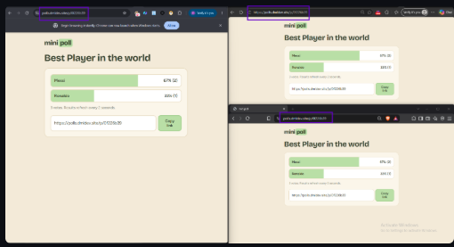
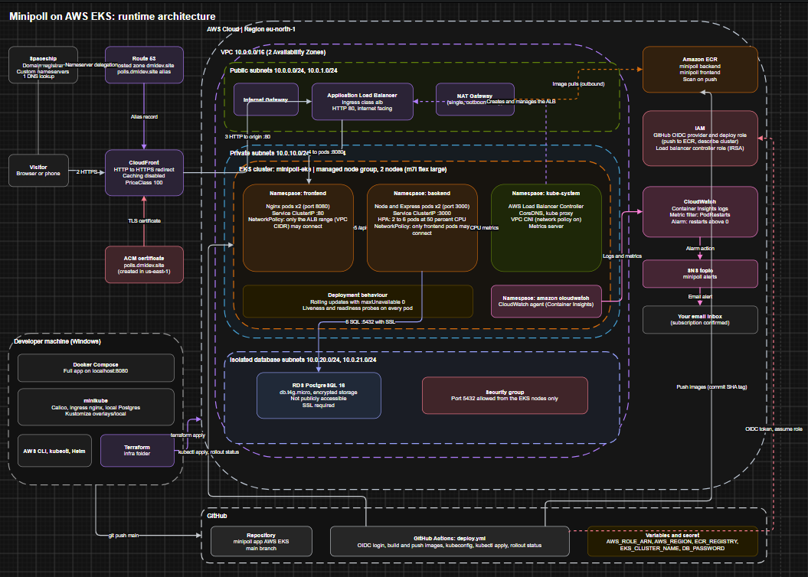
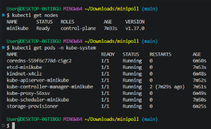
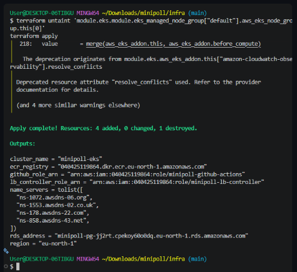
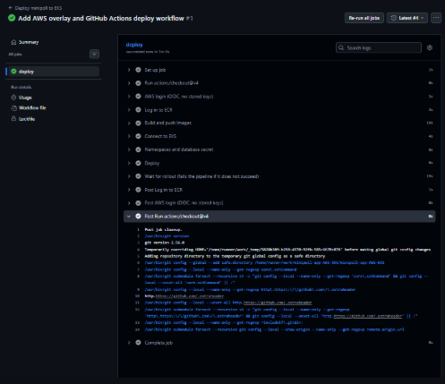
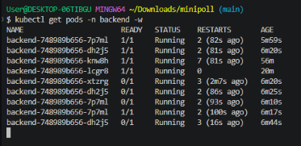
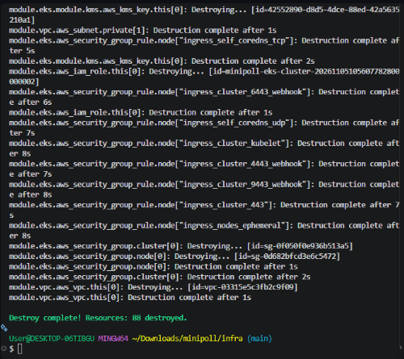

# Minipoll on AWS EKS

A small three tier poll app, taken from a Docker Compose setup on a laptop all the way to a live deployment on AWS EKS, with Terraform, GitHub Actions, CloudFront and monitoring along the way.

Create a poll, share the link, collect votes and see the results. The app itself is simple on purpose, so the real focus of this repository is how it gets built, shipped, secured and watched in the cloud.

I wrote a full beginner friendly walkthrough that explains every step, including the errors I ran into and how I fixed them:

**[Read the Hashnode guide](https://dmlops.hashnode.dev/deploying-a-three-tier-app-on-aws-eks-with-terraform-ecr-cloudfront-and-github-actions)**



---

## Project Overview

Minipoll has three tiers:

1. A static frontend served by Nginx
2. A Node and Express backend API
3. A PostgreSQL database

You can run it in three different ways, and each one teaches something new:

1. **Docker Compose** on your own machine, to prove the app works
2. **Kubernetes on minikube**, to practise manifests, autoscaling and network policies for free
3. **AWS EKS**, built with Terraform and deployed by a GitHub Actions pipeline

The same Kubernetes manifests are reused in every environment. Kustomize overlays handle the small differences, such as image names, the database host and the ingress class.

---

## Technologies Used

**Application**
Nginx, Node.js, Express, PostgreSQL

**Containers and orchestration**
Docker, Docker Compose, Kubernetes, minikube, Calico, Kustomize, Helm

**Cloud and infrastructure**
AWS EKS, RDS PostgreSQL, ECR, VPC with NAT gateway, Application Load Balancer, CloudFront, ACM, Route 53, IAM, CloudWatch Container Insights, SNS

**Infrastructure as code and CI/CD**
Terraform (with the community VPC and EKS modules), GitHub Actions with OIDC

**Tooling**
AWS CLI, kubectl, Git Bash, VS Code, winget

---

## Project Structure



The files `edge.tf` and `monitoring.tf` are added later in the setup, once the load balancer exists.

---

## Main Features

**Three tier architecture.** Frontend, backend and database run in separate Kubernetes namespaces, so each layer stays isolated.

**Self healing and zero downtime updates.** Liveness and readiness probes restart stuck containers and hold back traffic until pods are ready. Rolling updates with `maxUnavailable: 0` keep the app serving requests during a deploy.

**Horizontal autoscaling.** The backend scales from 2 up to 6 pods when CPU use passes 50 percent.

**Locked down networking.** NetworkPolicies deny everything by default, then allow only internet to frontend, frontend to backend and backend to database. On AWS, the database sits in isolated subnets and is not publicly accessible.

**Keyless deployments.** GitHub Actions logs in to AWS using OIDC, so no access keys are stored in GitHub. The deploy role can only push images and describe the cluster.

**One codebase, many environments.** Kustomize overlays swap the ingress class, image registry and database settings without duplicating manifests.

**HTTPS on a custom domain.** CloudFront with a free ACM certificate redirects HTTP to HTTPS on `polls.dmldev.site`.

**Monitoring with a real alert.** Container Insights feeds a CloudWatch alarm that emails you when a container restarts.

---

## Setup Instructions

### 1. What you need

You will need a Windows PC with Docker Desktop, Git Bash and VS Code, plus an AWS account, a GitHub account and a domain name. This project uses `dmldev.site`, so swap in your own.

Install the command line tools:

```bash
winget install -e --id Amazon.AWSCLI
winget install -e --id Hashicorp.Terraform
winget install -e --id Helm.Helm
winget install -e --id Kubernetes.kubectl
winget install -e --id Kubernetes.minikube
```

Close and reopen your terminal, then check each tool with `aws --version`, `terraform version`, `helm version`, `kubectl version --client` and `minikube version`.

### 2. Prepare your AWS account

Turn on MFA for the root user and set a small monthly budget alert. Then create an IAM user for daily work, generate a CLI access key, and connect your terminal:

```bash
aws configure
aws sts get-caller-identity
```

Use the region `eu-north-1` and never commit your keys.

### 3. Run it with Docker Compose

```bash
git clone https://github.com/dml-ops/minipoll-app-AWS-EKS.git
cd minipoll-app-AWS-EKS
docker compose up -d --build
curl http://localhost:8080/api/healthz
```

You should get `{"ok":true}`. Open http://localhost:8080 and create a poll. When you are done, run `docker compose down`.

### 4. Run it on minikube

```bash
export MSYS_NO_PATHCONV=1
minikube start --driver=docker --cni=calico --cpus=2 --memory=3072 --wait-timeout=15m
minikube addons enable ingress
minikube addons enable metrics-server
```

Build the images and load them into the cluster:

```bash
docker build -t minipoll-backend:dev ./backend
docker build -t minipoll-frontend:dev ./frontend
minikube image load minipoll-backend:dev
minikube image load minipoll-frontend:dev
```

Create the namespaces, the local database and the secrets:

```bash
kubectl apply -f k8s/base/namespaces.yaml
kubectl apply -f k8s/local-db/postgres.yaml

kubectl create secret generic postgres-credentials -n database \
  --from-literal=POSTGRES_USER=minipoll \
  --from-literal=POSTGRES_PASSWORD=localpass \
  --from-literal=POSTGRES_DB=minipoll

kubectl create secret generic db-credentials -n backend \
  --from-literal=DB_USER=minipoll \
  --from-literal=DB_PASSWORD=localpass

kubectl apply -k k8s/overlays/local
```

In a second terminal tab, start the tunnel and keep it running:

```bash
minikube tunnel
```

Then open http://127.0.0.1.



### 5. Build the AWS infrastructure

Pick the newest Kubernetes version that is still in standard support:

```bash
aws eks describe-cluster-versions --region eu-north-1 \
  --query "clusterVersions[?status=='STANDARD_SUPPORT'].clusterVersion" --output text
```

Create `infra/terraform.tfvars`. This file is ignored by Git, so keep it that way:

```hcl
kubernetes_version = "1.34"
db_password        = "<LETTERS_AND_NUMBERS_ONLY_12+_CHARS>"
alert_email        = "<your-email@example.com>"
```

Then run Terraform. Expect 15 to 25 minutes:

```bash
cd infra
terraform init
terraform validate
terraform plan
terraform apply
```

If your account is on a restricted free plan, set `node_instance_type` to `m7i-flex.large`, because `t3.medium` may be blocked.

Next, run `terraform output name_servers` and enter those four values as custom nameservers at your domain registrar.



### 6. Connect kubectl and install the load balancer controller

```bash
aws eks update-kubeconfig --region eu-north-1 --name minipoll-eks
kubectl get nodes

ROLE_ARN=$(terraform -chdir=infra output -raw lb_controller_role_arn)
VPC_ID=$(aws ec2 describe-vpcs --region eu-north-1 \
  --filters "Name=tag:Name,Values=minipoll-vpc" --query "Vpcs[0].VpcId" --output text)

helm repo add eks https://aws.github.io/eks-charts
helm repo update
helm install aws-load-balancer-controller eks/aws-load-balancer-controller \
  -n kube-system \
  --set clusterName=minipoll-eks \
  --set region=eu-north-1 \
  --set vpcId=$VPC_ID \
  --set serviceAccount.create=true \
  --set serviceAccount.name=aws-load-balancer-controller \
  --set 'serviceAccount.annotations.eks\.amazonaws\.com/role-arn'=$ROLE_ARN
```

### 7. Fill in the AWS overlay

Replace the placeholders in `k8s/overlays/aws/kustomization.yaml` with your real values. Leave `IMAGE_TAG` alone, because the pipeline sets it.

```bash
sed -i "s|ECR_REGISTRY|$(terraform -chdir=infra output -raw ecr_registry)|g" k8s/overlays/aws/kustomization.yaml
sed -i "s|RDS_ADDRESS|$(terraform -chdir=infra output -raw rds_address)|g" k8s/overlays/aws/kustomization.yaml
```

### 8. Configure GitHub Actions

In your repository, open Settings, then Secrets and variables, then Actions.

Add these as **repository variables**:

| Name | Value |
|---|---|
| `AWS_ROLE_ARN` | Output of `terraform output -raw github_role_arn` |
| `AWS_REGION` | `eu-north-1` |
| `ECR_REGISTRY` | Output of `terraform output -raw ecr_registry` |
| `EKS_CLUSTER_NAME` | `minipoll-eks` |

Add this as a **repository secret**:

| Name | Value |
|---|---|
| `DB_PASSWORD` | The same password you used in `terraform.tfvars` |

If the pipeline cannot assume the AWS role, check the exact identity GitHub sends in CloudTrail and set `github_repo` in `variables.tf` to match. The guide explains this in detail.

Now push to `main`:

```bash
git add .
git commit -m "Deploy minipoll to EKS"
git push origin main
```



### 9. Add HTTPS with CloudFront

Once the ALB has an address, pass it to Terraform and add `infra/edge.tf` from the blog post:

```bash
ALB=$(kubectl get ingress minipoll -n frontend -o jsonpath='{.status.loadBalancer.ingress[0].hostname}')
echo "alb_dns_name = \"$ALB\"" >> infra/terraform.tfvars
cd infra
terraform apply
```

Wait for the nameserver change to propagate first, or the certificate will not validate.

### 10. Add monitoring

Add `infra/monitoring.tf` from the blog post and run `terraform apply` again. Then click the confirmation link in the email from AWS, otherwise no alerts will reach you.

---

## Workflow Usage Guide

**Deploying a change.** Edit the code, commit and push to `main`. The pipeline builds both images, tags them with the commit SHA, pushes them to ECR, applies the overlay and waits for the rollout. A red run means the pods did not become ready.

**Checking the app.**

```bash
kubectl config current-context
kubectl get pods -A
kubectl get ingress -n frontend
curl -i https://polls.dmldev.site/api/healthz
```

Always check your current context before applying anything, because you will have both minikube and EKS configured.

**Watching autoscaling.** Temporarily set `ENABLE_DEBUG` to `"true"` in the AWS overlay, push, then generate load against the burn endpoint while you watch:

```bash
kubectl get hpa -n backend -w
```



**Testing the alert.** With debug on, call the crash endpoint and watch a pod restart. The CloudWatch alarm should turn red and an email should arrive within a few minutes.

```bash
curl https://polls.dmldev.site/api/debug/crash
kubectl get pods -n backend
```

Set `ENABLE_DEBUG` back to `"false"` afterwards. Debug endpoints should never stay on in a deployed app.

**Proving the network rules.** A random pod should time out when calling the backend, while a frontend pod should succeed:

```bash
kubectl run tmp --rm -i --restart=Never --image=busybox -n default -- \
  wget -qO- -T3 http://backend.backend.svc.cluster.local:3000/api/healthz

kubectl exec -n frontend deploy/frontend -- \
  wget -qO- -T3 http://backend.backend.svc.cluster.local:3000/api/healthz
```

---

## Tearing Everything Down

AWS bills by the hour, so clean up when you are finished. Order matters.

```bash
kubectl delete ingress minipoll -n frontend
helm uninstall aws-load-balancer-controller -n kube-system
cd infra
terraform destroy
```



Then delete the leftover CloudWatch log groups for the cluster, restore your domain's nameservers at your registrar, and run `minikube stop`. Finally, confirm that no EKS clusters, RDS instances, NAT gateways, Elastic IPs, ECR repositories or CloudFront distributions remain, and check the Billing page the following day.

---

## What I Would Improve Next

Restrict the load balancer so only CloudFront can reach it, narrow the cluster admin permissions given to GitHub Actions, and move database credentials into AWS Secrets Manager.

---

## Learn More

The full step by step walkthrough, with explanations and every error I hit, is on Hashnode:

https://dmlops.hashnode.dev/deploying-a-three-tier-app-on-aws-eks-with-terraform-ecr-cloudfront-and-github-actions

If something here helped you or you got stuck, feel free to open an issue or leave a comment on the post.
